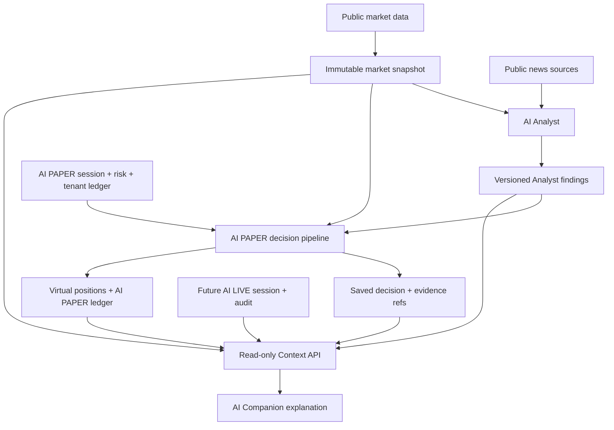

# ADR — Shared intelligence context for Companion, Analyst and AI PAPER

**Date:** 2026-11-20  
**Status:** Report-only recommendation; no source code, schema, migration, or deployment changes.  
**Decision:** Build a versioned, tenant-scoped, read-only context contract. It is an evidence boundary between the three components, not a shared writable memory and not a new trading mode.

## 1. Executive decision

Kripto Guru should share **verified evidence**, not unrestricted memory:

1. **AI Analyst** reads public market/news sources and publishes structured, timestamped findings with provenance. It does not read private user positions and cannot execute trades.
2. **AI PAPER / AI Piper** reads server-owned market snapshots, eligible Analyst findings, and its own tenant's session/risk/ledger state. It creates decisions through existing risk/session gates and records the evidence references used.
3. **AI Companion** reads only the authenticated user's permitted context and explains already-saved decisions, positions, ledger events and audit evidence. It cannot create or modify decisions, positions, sessions or orders.

The direction is one-way:

`Public market/news → Analyst findings → AI PAPER decision → virtual ledger/positions → read-only Context API → Companion explanation`

Companion output must never become evidence for Analyst or AI PAPER. AI PAPER rationale is captured at decision time; Companion must not invent or generate a retrospective rationale.

For the future LIVE path, AI LIVE may execute only inside an explicitly started, bounded, server-authorized session with hard limits and a kill/revoke path. Companion receives only a read-only audit projection. **AI LIVE session authorization and audit-context storage are NOT IMPLEMENTED/NOT VERIFIED in the current code.**

## 2. Current repository evidence and gaps

### 2.1 Authentication and tenant boundary

- `src/api.ts:25-42` validates Telegram initData, obtains `telegramUserId`, and constructs `scopedEnv = tenantEnv(env, telegramUserId)`. It rejects unauthenticated requests before parsing their bodies.
- `src/tenants.ts:13-45` prefixes per-user KV keys with `tenant:<userId>:`.
- `src/companion.ts:18-29` independently validates Telegram initData and uses the same tenant-scoped KV wrapper.
- AI PAPER engine queries in `src/trading/engine.ts:154-194`, `:492-759`, and `:772-840` bind SQL reads/writes to the authenticated `user_id`.

**Implication:** the context provider must derive tenant ID from the authenticated Worker request, never from a client-supplied `userId` field. Every private SQL lookup must include `user_id = ?`. Public market/news evidence may be global, but private account data must never enter a shared cache without a tenant key.

### 2.2 AI PAPER account, ledger, positions and decisions

The current `TradingEngine` SQLite schema in `src/trading/engine.ts:80-104` contains separate AI PAPER tables:

- `ai_paper_accounts`: `user_id`, virtual balance, `status`, strategy ID/version, risk config JSON, created/updated timestamps.
- `ai_paper_ledger`: idempotency key, kind, amount, balance before/after, reference ID, created timestamp.
- `ai_paper_positions`: symbol, side, quantity, entry price, margin, leverage, fees/slippage, stop/take-profit, open/closed status, timestamps and `close_json`.
- `ai_paper_decisions`: tick ID, strategy ID/version, market snapshot hash, symbol, BUY/SELL/HOLD signal, rationale, confidence, observed price, risk pass/rejection reason, linked position ID and created timestamp. Draft PR #616 adds separate `snapshot_retrieved_at` and `risk_evaluated` fields; `created_at` remains the decision-record timestamp. For its analysis-only `gemini-paper` strategy, `riskPass=false` and `riskEvaluated=false` mean “not evaluated”, not “risk rejected”.

Existing read routes are:
- `GET /ai/paper/status` — `src/trading/engine.ts:154-160`, status projection in `:842-866`.
- `GET /ai/paper/decisions` — `:161-173`.
- `GET /ai/paper/positions` — `:174-195`.
- Mini App routes are authenticated and scoped in `src/api.ts:53-70`.

**Gaps confirmed from the current schema:**
- `ai_paper_accounts` stores a status and strategy, but no durable session ID, started-at, expiry, stop reason, authorization scope, or revocation record.
- `ai_paper_decisions` on main stores a `market_snapshot_hash` and one `observed_price`, but no full immutable snapshot payload or source-reference list. Draft PR #616 adds `snapshot_retrieved_at` separately from decision `created_at`, but a hash alone still cannot reconstruct the snapshot.
- `ai_paper_ledger` is a financial-operation ledger, not a complete audit-event stream for every analysis, risk rejection, scheduler action or session transition.
- The current API exposes status, decisions and positions, but no user-facing read route for the AI PAPER ledger.

A draft, unmerged implementation in [PR #616](https://github.com/hjfhjfukbgh-design/walletbot-mcp/pull/616) generates a public Hyperliquid snapshot, hashes it, and sends it to Gemini. It now persists `snapshotRetrievedAt` separately from decision `createdAt`, but the public contract response exposes no per-quote exchange timestamp: `snapshotRetrievedAt` is when the Worker retrieved the response, not when Hyperliquid says the quote was observed. The 10-minute check measures time since Worker retrieval, not upstream quote age. The full snapshot payload is still not persisted; a hash cannot reconstruct it. This PR is Draft and is not part of main.

### 2.3 Market and news evidence

- `src/prices.ts:20-56` reads public Hyperliquid `metaAndAssetCtxs` data and maps symbol, price, 24h volume, funding and 24h change.
- `src/prices.ts:3-14` reads public mid prices.
- The draft AI PAPER generator in PR #616 uses the public Hyperliquid source, a Worker retrieval timestamp, and a maximum 10-minute age since retrieval (`src/ai-paper.ts:17-18, 140-145`). The upstream response does not provide a per-quote observation timestamp, so this is not proof of exchange-side quote freshness.
- No `src/analyst.ts`, news ingestion service, Analyst findings table, or persistent market-snapshot table exists in `src/`. `src/strategy/grid.ts` is a trading/grid strategy module, not an AI Analyst.
- `team/reports/role-analyst-issue-445-44626257711.md` is a Mini App capability report, not an Analyst runtime implementation.

**Status:** market prices exist; persistent immutable snapshots and Analyst news findings are NOT IMPLEMENTED. Do not describe public price retrieval as a completed Analyst/news pipeline.

### 2.4 Companion is currently isolated from account context

- `src/companion.ts:4-16` defines chat message/conversation records and the 20-message storage cap / 8-message context window.
- `src/companion.ts:18-29` authenticates Telegram and scopes KV to the user.
- `src/companion.ts:43-60` lists, reads and deletes Companion conversations.
- `src/companion.ts:62-70` accepts only Companion modes `general`, `learning`, and `research`. These are chat modes, not product market modes.
- The general Companion system prompt in `src/companion.ts:100-110` explicitly says it has no access to accounts, API tools or trade execution.
- `src/companion.ts:180-240` calls Gemini and persists chat messages/sources. Research sources are currently title+URL; no source published-at, retrieved-at, content hash or freshness state is persisted.
- There is no Companion route that reads AI PAPER status, decisions, positions or ledger.

**Implication:** the requested “What is my AI doing and why?” experience does not exist yet. It needs a dedicated read-only context provider; simply changing the Companion prompt would be unsafe because the required evidence is not currently supplied.

### 2.5 Manual DEMO, AI PAPER and LIVE are distinct data domains

- `src/state.ts:4, 29-35` currently retains a legacy `ProductMode = "demo" | "live" | "ai"` value. The approved product hierarchy is two top-level market modes (DEMO/LIVE) with Manual/AI as the method inside each. The pending UI work in PR #630 reflects that hierarchy; it does not by itself migrate the backend state contract.
- Manual DEMO positions are also represented in `src/manual.ts:8-24, 47-53, 82-118` using tenant-scoped KV.
- The engine has separate manual account/positions/ledger tables and separate AI PAPER account/positions/ledger/decisions tables (`src/trading/engine.ts:80-104`).
- Manual LIVE preview/execute/status routes exist in `src/api.ts:75-80, 87-90`. `src/walt.ts:79-92` explicitly disables legacy automatic open/close methods and requires the separate preview/confirmation path.
- The `live_operations` table in `src/trading/engine.ts:94` is for bounded manual LIVE operation records. No AI LIVE session authorization table or AI LIVE audit stream is present.

**Implication:** the context contract must carry both `marketMode` and `method` as separate dimensions. It must never merge Manual DEMO positions with AI PAPER positions or present a Manual LIVE operation as an AI LIVE action.

## 3. Proposed versioned context contract

This is a **proposed contract**, not an assertion that these fields or endpoints already exist.

### 3.1 Envelope

```ts
type AiContextEnvelopeV1 = {
  schemaVersion: "kg.ai-context.v1";
  scope: {
    tenantUserId: string;       // derived by the authenticated Worker
    marketMode: "DEMO" | "LIVE";
    method: "MANUAL" | "AI";
    accountKind: "manual-demo" | "ai-paper" | "manual-live" | "ai-live";
  };
  generatedAt: string;
  completeness: "complete" | "partial";
  evidence: {
    session?: SessionEvidence;
    decisions: DecisionEvidence[];
    positions: PositionEvidence[];
    ledger: LedgerEvidence[];
    marketSnapshots: SnapshotEvidence[];
    analystFindings: AnalystFindingEvidence[];
    auditEvents: AuditEvidence[];
  };
  unavailable: Array<{
    section: string;
    state: "missing" | "stale" | "not_implemented" | "unauthorized" | "source_unavailable";
    reason: string;
  }>;
};
```

### 3.2 Evidence record

Every record returned to Companion must include provenance and freshness, not just free-form text:

```ts
type EvidenceMeta = {
  evidenceId: string;
  sourceType: string;
  sourceRecordId: string;
  observedAt: string | null;     // null if the provider supplies no source timestamp
  recordedAt: string;            // time received/persisted by our service
  contentHash: string | null;
  freshness: "fresh" | "stale" | "missing" | "unknown" | "not_applicable";
  maxAgeSeconds: number | null;
};

type DecisionEvidence = EvidenceMeta & {
  decisionId: string;
  signal: "buy" | "sell" | "hold";
  rationale: string;
  riskEvaluated: boolean;
  riskPass: boolean | null;      // null when riskEvaluated is false
  rejectionReason: string | null;
  snapshotRetrievedAt: string | null;
};

type SnapshotEvidence = EvidenceMeta & {
  snapshotId: string;
  source: string;
  retrievedAt: string;
  sourceObservedAt: string | null;
};
```

The existing AI PAPER fields map to this envelope as follows:
- decision ID, tick ID, strategy ID/version, signal, symbol, rationale, confidence, `riskEvaluated`, risk pass/rejection, position ID, snapshot retrieval time and decision creation time come from `ai_paper_decisions`; if `riskEvaluated=false`, context maps `riskPass` to null and must not call the decision rejected;
- position data comes from `ai_paper_positions`;
- funding/withdrawal/open/close accounting comes from `ai_paper_ledger`;
- session status and strategy ID/version come from `ai_paper_accounts`;
- the full market snapshot payload and Analyst findings are currently missing and must be persisted by future work. PR #616's retrieval timestamp does not substitute for a source-provided observation timestamp.

### 3.3 Snapshot and Analyst finding records

Proposed immutable snapshot record:

```ts
type MarketSnapshotV1 = EvidenceMeta & {
  schemaVersion: "kg.market-snapshot.v1";
  source: "hyperliquid-public" | string;
  retrievedAt: string;
  sourceObservedAt: string | null;
  markets: Array<{
    symbol: string;
    price: string;
    volume24hUsd: number;
    fundingRateHourly?: number;
  }>;
};
```

Proposed Analyst finding record:

```ts
type AnalystFindingV1 = EvidenceMeta & {
  schemaVersion: "kg.analyst-finding.v1";
  findingType: string;
  summary: string;
  assessment: string;
  confidence: number | null;
  sourceRefs: Array<{
    url: string;
    title: string;
    publisher?: string;
    publishedAt?: string | null;
    retrievedAt: string;
    contentHash?: string | null;
  }>;
  modelId: string;
  promptVersion: string;
};
```

No Analyst model ID, news provider, findings schema, or source freshness TTL is confirmed in current code. Those values remain NOT VERIFIED until the Analyst implementation chooses and tests them.

## 4. Permission matrix

| Component | May read | May write | Must never do |
|---|---|---|---|
| Companion | Authenticated tenant's approved context, saved decisions, positions, ledger and audit projection; public docs | Its own chat history only | Change sessions, decisions, risk limits, balances, positions or orders; invent a rationale |
| Analyst | Public market snapshots and public news/source material | Versioned Analyst findings with provenance | Read private tenant positions/balances; execute trades; treat Companion output as evidence |
| AI PAPER | Fresh server-owned market snapshot, eligible Analyst findings, its own tenant's session/risk/ledger/positions | AI PAPER decision ledger and virtual positions through existing Engine gates | Touch Manual DEMO ledger, LIVE account, Walt or another tenant |
| Manual DEMO | Its own virtual account/market state | Manual DEMO positions through explicit user action | Write AI PAPER or LIVE state |
| Manual LIVE | Its own account/preview/operation state | Only after preview and individual user confirmation | Autonomous execution without confirmation |
| AI LIVE (future) | Its own authorized session, risk, market and audit state | Only through a bounded server-authorized session and hard server limits | Auto-start, exceed authorization, or bypass revoke/kill switch |
| Companion explaining LIVE (future) | Read-only AI LIVE audit projection for the authenticated tenant | Chat history only | Start, stop, amend or execute LIVE operations |

### Required invariants

1. Companion's context API is read-only and derives tenant identity from Telegram auth.
2. Analyst findings are public-evidence products, not private user advice or trade commands.
3. AI PAPER may use Analyst findings only when they are fresh, provenance-complete and permitted by the active strategy version.
4. A decision stores the exact evidence references used at decision time. Companion explains those references; it does not call Gemini to invent missing reasoning.
5. AI LIVE uses a separate session-authorized execution path. Companion receives only audit data and cannot call the execution path.

## 5. Sequence flow and anti-circularity



Anti-circularity rules:
- Analyst findings cite original market/news source references, not Companion answers or AI PAPER rationales.
- AI PAPER decision records cite the snapshot hash/ID and the Analyst finding IDs used. A finding may inform a decision but cannot validate itself.
- Companion reads the persisted decision rationale and its evidence references. It may summarize them in natural language, but must not generate a new rationale and present it as the original reason.
- If evidence is absent or stale, Companion says so; AI PAPER blocks a new decision when required evidence is missing/stale.
- Companion responses are never written back into Analyst findings or AI PAPER decision evidence.

## 6. Freshness and provenance policy

- Every market snapshot carries provider/source, symbol, Worker `retrievedAt`, optional provider `sourceObservedAt` (null when unavailable), and immutable content hash.
- The draft AI PAPER implementation in PR #616 checks that Worker `retrievedAt` is no more than 10 minutes old when persisting the decision (`src/ai-paper.ts:17-18, 140-145, 256-258`). This is not an upstream quote-age guarantee and is not a universal TTL for all context sources.
- News freshness must be source-specific. No news source or TTL is implemented; do not invent a global news age. Until a policy is approved, findings without a verifiable publication/retrieval timestamp are `unknown` and cannot satisfy a strategy's required-evidence gate.
- A saved decision remains a historical fact even after its market snapshot becomes stale. Companion may explain it as historical, with the Worker retrieval time and a clear note that no upstream quote timestamp was supplied, but must not present it as a current recommendation.
- Hash mismatch, missing snapshot payload, or missing source references must be represented explicitly; a hash is an integrity fingerprint, not a replacement for the underlying snapshot.

## 7. Failure states and required behavior

| State | Context API behavior | Companion behavior | AI PAPER behavior |
|---|---|---|---|
| `fresh` | Return evidence + provenance | Explain with timestamps | May proceed through risk/session gates |
| `stale` | Return record with stale marker | Explain as historical, warn it is stale | Block if the strategy requires fresh evidence |
| `missing` | Explicit unavailable section | Say evidence is not available | Block if required evidence is missing |
| `partial` | Return available sections and missing list | State exactly what is missing | Fail closed for required missing inputs |
| `unauthorized` / `tenant_mismatch` | 401/403; no partial cross-tenant data | No disclosure | No action |
| `source_unavailable` | Mark source unavailable with last observation | Explain outage and last-known timestamp | No new decision from unverified fallback |
| `snapshot_hash_mismatch` | Mark integrity failure | Do not explain as verified | Block |
| `decision_not_found` | Return explicit not-found | Say no saved decision exists | No invented rationale |
| `audit_gap` | Return explicit audit gap | State that complete history is unavailable | No LIVE execution if audit requirements are unmet |
| `not_implemented` | Return explicit capability status | Say the feature is not yet connected | Do not assume Analyst/AI LIVE exists |

## 8. API boundary (proposed, not yet implemented)

Add one internal, read-only context provider, e.g. `getAiContextV1(authenticatedTenantId, scope)`. The Worker authenticates Telegram once, then passes the derived tenant ID to the provider. Do not expose arbitrary tenant IDs in request bodies.

The provider should:
1. Validate `marketMode` and `method` against the approved two-level hierarchy.
2. Resolve the correct account domain (Manual DEMO, AI PAPER, Manual LIVE, future AI LIVE).
3. Read only that tenant's session/decision/position/ledger/audit records.
4. Attach source IDs, timestamps, hashes and freshness.
5. Return a partial envelope with explicit unavailable sections rather than silently substituting data.
6. Enforce response-size and history limits; Companion receives only the minimal evidence required to answer the question.

The current API has separate endpoints for AI PAPER status/decisions/positions and manual LIVE/DEMO routes (`src/api.ts:53-100`); no shared context endpoint currently exists. The proposed provider is an aggregation boundary, not a new trading execution API.

## 9. Two-level mode mapping

The persisted legacy `ProductMode` type in `src/state.ts:4, 29-35` currently contains `demo | live | ai`. The approved product contract is:

- `marketMode = DEMO`, `method = MANUAL`
- `marketMode = DEMO`, `method = AI` (AI PAPER / AI Piper)
- `marketMode = LIVE`, `method = MANUAL`
- `marketMode = LIVE`, `method = AI` (future AI LIVE, blocked until authorization/session/audit controls exist)

Legacy mapping for migration only:
- `productMode=demo` → DEMO + Manual
- `productMode=ai` → DEMO + AI
- `productMode=live` → LIVE + Manual

Do not create a third top-level mode called AI. Do not infer AI LIVE readiness from the legacy `live` value.

## 10. Implementation phases

1. **Context contract + aggregator:** versioned schema, tenant-scope enforcement, read-only Engine methods, evidence refs, explicit missing/stale states, permission tests.
2. **Analyst findings pipeline:** public market/news ingestion, structured findings, source provenance, publication/retrieval timestamps, freshness policy, versioned storage. No paid APIs or unapproved services.
3. **AI PAPER evidence completion:** persist immutable market snapshots (not just hashes), attach snapshot/finding IDs to decisions, persist risk rejection/stop reasons and session lifecycle evidence.
4. **Companion explanation:** read the context envelope and explain saved AI PAPER decisions/positions/ledger using only evidence refs; keep general chat independent and research sources separately attributed.
5. **AI LIVE later:** only after bounded authorization session, hard limits, revoke/kill switch, reconciliation and immutable audit trail are implemented and verified. Companion remains read-only.

## 11. Required regression tests

1. Same Telegram user sees only their own context; same conversation/account IDs across two users cannot cross-read.
2. Companion context route rejects caller-supplied `userId` and uses Telegram initData identity.
3. Manual DEMO and AI PAPER accounts/positions never mix.
4. LIVE Manual and future AI LIVE evidence are distinct; no AI LIVE context is returned before the authorization/audit contract exists.
5. Fresh/stale/missing/partial evidence states are explicit and deterministic.
6. Market snapshot hash is checked against a persisted immutable payload; `retrievedAt` is distinguished from provider `sourceObservedAt` and is never presented as an exchange timestamp.
7. AI PAPER decision includes snapshot ID/hash, Worker retrieval timestamp, optional provider observation timestamp, strategy version and Analyst finding IDs used.
8. Companion explains a saved decision from persisted rationale/evidence without a second model-generated rationale.
9. Missing/stale required evidence blocks new AI PAPER decisions.
10. Analyst finding provenance includes original public source refs, publication/retrieval timestamps and content hash.
11. Analyst findings cannot include private tenant account/position data.
12. Context API read-only tests prove no writes to session, balance, ledger, positions or Walt operations.
13. AI LIVE context is unavailable until session authorization and audit requirements pass.

## 12. Implementation-sized follow-ups

1. **#637 — Shared context contract v1:** typed envelope, tenant-scoped read-only aggregator, provenance/freshness and permission tests. Blocked until this ADR is accepted.
2. **#638 — Analyst pipeline:** public market/news ingestion and versioned findings with provenance; depends on #637.
3. **#639 — AI PAPER evidence persistence:** immutable snapshot payloads and exact Analyst finding refs on decisions; depends on #637, PR #616 and scheduler #635.
4. **#640 — Companion explanation:** read-only explanation of saved decisions/positions/ledger using context evidence; depends on #637 and Companion API migration #633.

## Conclusion

The repository already has useful building blocks—Telegram-derived tenant identity, separate AI PAPER account/ledger/positions/decisions, public Hyperliquid market data, and a read-only Companion chat boundary—but it does **not** yet have an Analyst runtime, immutable market-snapshot store, shared context API, complete session lifecycle/audit stream, or AI LIVE authorization context.

The safe architecture is a versioned evidence contract with explicit provenance, freshness, tenant scope and read-only permissions. It must make missing capabilities visible rather than fabricate them. All new fields/endpoints in this ADR are proposals until implemented and tested.
